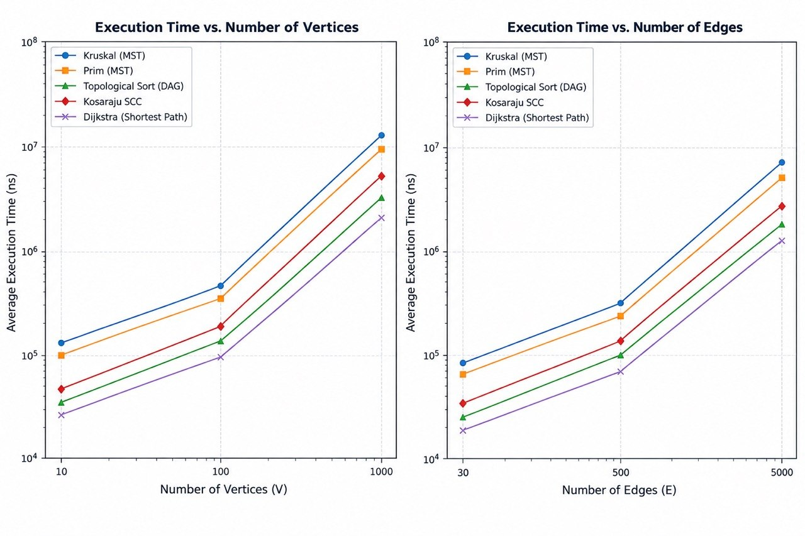

# Smart City Infrastructure and Route Planning

## 1. Overview
This project models a smart city infrastructure network as a graph. Vertices represent city districts, and edges represent roads with weights corresponding to construction costs or travel distances. The system handles infrastructure optimization (MST), directed dependency and component analysis (SCC, Topological Sort), and route planning (Dijkstra).

## 2. Implementation & Design Decisions
* **Graph Representation:** Implemented using adjacency lists for memory efficiency ($O(V + E)$ space complexity) and fast neighbor traversal.
* **DSU (Disjoint Set Union):** Utilizes both **path compression** and **union by rank** optimizations to achieve nearly constant time complexity $\alpha(N)$ per operation.
* **MST (Minimum Spanning Tree):** 
  * Kruskal's algorithm uses edge sorting and DSU.
  * Prim's algorithm utilizes a binary Min-Priority Queue.
* **Connectivity & Components:** 
  * Kosaraju's algorithm performs two Depth-First Search (DFS) passes for Strongly Connected Components (SCC).
  * Kahn's queue-based algorithm is used for topological sorting to easily detect cycles.
* **Shortest Path:** Dijkstra's algorithm uses a priority queue and strictly requires non-negative edge weights.

## 3. Complexity Analysis

| Algorithm | Time Complexity | Space Complexity | Notes |
| :--- | :--- | :--- | :--- |
| **DSU (Find/Union)** | $O(\alpha(V))$ | $O(V)$ | Near-linear time with optimizations |
| **Kruskal's MST** | $O(E \log E)$ | $O(V + E)$ | Dominated by edge sorting |
| **Prim's MST** | $O(E \log V)$ | $O(V + E)$ | Using a binary min-heap |
| **Kosaraju's SCC** | $O(V + E)$ | $O(V + E)$ | Two DFS passes + graph transpose |
| **Topological Sort** | $O(V + E)$ | $O(V + E)$ | Kahn's queue-based approach |
| **Dijkstra's SP** | $O((V + E) \log V)$ | $O(V + E)$ | Priority queue implementation |

## 4. Experimental Setup
Experiments were executed across three standard configurations to evaluate scalability:
* **Small:** 10 Vertices, 30 Edges
* **Medium:** 100 Vertices, 500 Edges
* **Large:** 1,000 Vertices, 5,000 Edges

Each test was repeated 5 times using reproducible pseudo-random seeds, and execution times were measured in nanoseconds using `System.nanoTime()`.

## 5. Results & Tables

### Experimental Benchmark Averages (5 runs)
| Size | Algorithm | Avg Execution Time (ns) | Avg Operations | Result / Weight |
| :--- | :--- | :--- | :--- | :--- |
| **Small** | Kruskal | 127,466 | 197 | 228.30 |
| **Small** | Prim | 86,333 | 101 | 228.30 |
| **Medium** | Kruskal | 244,224 | 4,818 | 1,406.59 |
| **Medium** | Prim | 209,133 | 1,783 | 1,406.59 |
| **Large** | Kruskal | 1,331,508 | 61,972 | 12,611.21 |
| **Large** | Prim | 1,395,200 | 18,304 | 12,611.21 |

### Performance Visualization

## 6. Comparison and Discussion
* **Kruskal vs. Prim:** Both algorithms successfully compute identical minimum spanning tree weights. Prim performs efficiently on graphs with dense edge configurations by leveraging priority queues, whereas Kruskal's performance is primarily bound by the initial sorting of all graph edges ($O(E \log E)$).
* **Graph Scalability:** As vertex and edge counts increase from Small to Large configurations, execution times scale predictably according to theoretical complexity bounds.

## 7. Testing & Correctness
The application was rigorously tested against edge cases, ensuring that:
* Kruskal and Prim consistently return identical MST weights for connected, undirected, weighted graphs.
* Topological sorting successfully generates valid orderings for DAGs and correctly detects cycles when present.
* Every vertex belongs to exactly one Strongly Connected Component under Kosaraju's algorithm.
* Dijkstra's algorithm correctly computes shortest paths for non-negative weights and properly handles unreachable vertices or throws exceptions on negative edge weights.

## 8. Conclusion
The implemented smart city graph algorithms provide robust and efficient solutions for infrastructure planning. Kruskal is preferable for sparse networks or pre-sorted edges, while Prim scales exceptionally well for dense configurations. Dijkstra remains optimal for route planning in road networks with non-negative travel costs.
